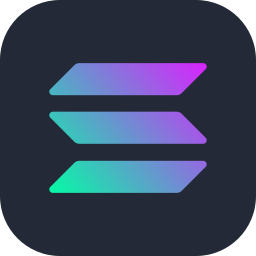
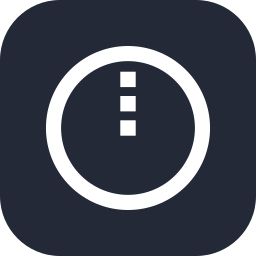
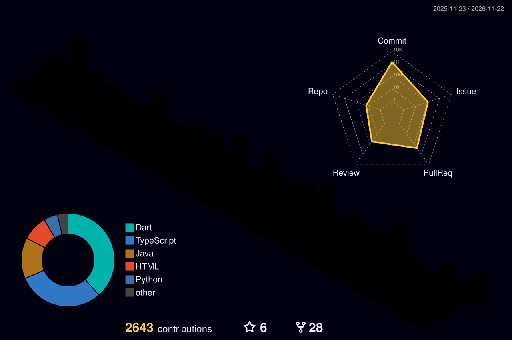

  
  

<!-- Quick Stats Banner -->

  
  

<!-- Committers Badge -->

  
   
  

---

## 💫 About Me

<table>
<tr>
<td>

🎓 **Student** at University of Moratuwa, Sri Lanka  
🚀 **Full Stack Developer** crafting modern web experiences  
☁️ **Exploring** Cloud Architecture & System Design  
🎨 **Passionate** Web3 | Cloud | Experiments  
📍 **Based in** Colombo, Sri Lanka  
🌐 **Read more?** My portfolio : www.shenrathnayaka.me

</td>
</tr>
</table>

---

## 🛠️ Tech Stack & Skills

---

## 🌐 Web3

  
  &nbsp;
  
  &nbsp;
  
  &nbsp;
  

---

## 📊 GitHub Analytics

<!-- GitHub Streak Stats -->

<!-- GitHub Stats Card -->

<!-- 3D Contribution Graph -->

---

## 🏆 Achievements

